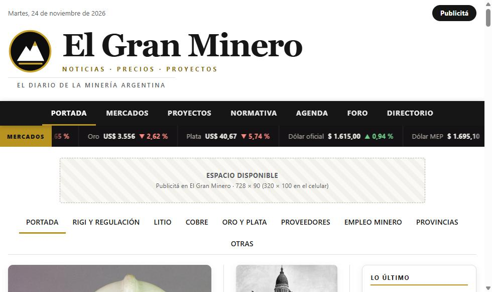
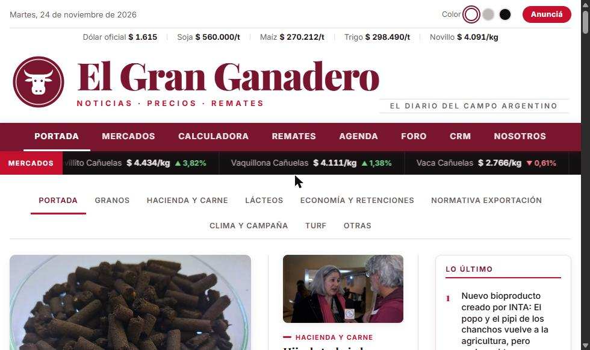
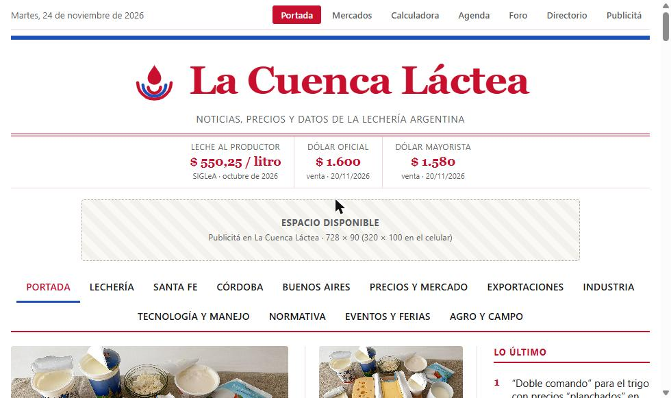

# Medios sectoriales

Cuatro diarios digitales que cubren la minería, la energía, el campo y la lechería de Argentina. Se actualizan solos varias veces por día y cada dato lleva su fuente y su hora.

**Fundador y director:** Federico Andrés Pepino · Córdoba, Argentina

---

## El Gran Minero
**[el-gran-minero.pages.dev](https://el-gran-minero.pages.dev)** · Litio, cobre, oro, plata y RIGI



Noticias del sector con enlace a la nota original, precios de metales, el mapa de 903 proyectos mineros de 15 provincias, el seguimiento de los proyectos con RIGI, normativa, agenda y foro.

## El Gran Energético
**[el-gran-energetico.pages.dev](https://el-gran-energetico.pages.dev)** · Petróleo, gas y Vaca Muerta

Noticias de petróleo, gas y minería, precios de WTI, gas natural y metales, proyectos, normativa y foro.

## El Gran Ganadero
**[el-gran-ganadero.pages.dev](https://el-gran-ganadero.pages.dev)** · Granos, hacienda y remates



Precios de granos y hacienda, calculadora, remates, agenda del sector y foro.

## La Cuenca Láctea
**[la-cuenca-lactea.pages.dev](https://la-cuenca-lactea.pages.dev)** · Lechería argentina



Precio de la leche al productor (SIGLeA), cotizaciones, noticias por provincia y calculadora.

---

## Cómo funcionan

```
fuentes oficiales y medios del sector
        │   Boletín Oficial · SIACAM · rigi.ar · SIGLeA
        ▼
GitHub Actions ── corre solo, varias veces por día
        │
        ▼
Cloudflare Pages · Functions · D1
        │
        ▼
4 portales · un mismo motor
```

Los cuatro portales comparten un mismo motor: cambian las fuentes, las secciones y la identidad visual de cada medio.

## Stack

`React` `TypeScript` `Cloudflare Pages` `Cloudflare Functions` `Cloudflare D1` `GitHub Actions` `n8n` `Claude Code`

## Sobre el código

El motor que arma los cuatro medios es privado: es la base del negocio y maneja datos de contacto de terceros. Este repositorio muestra qué hace y cómo está armado. Si querés verlo en funcionamiento o conversar sobre la arquitectura, escribime.

Los portales están desarrollados con IA (Claude Code). El diseño, la dirección editorial y la operación son míos.

## Contacto

[LinkedIn](https://www.linkedin.com/in/federicopepino/) · fedepepino003@gmail.com
